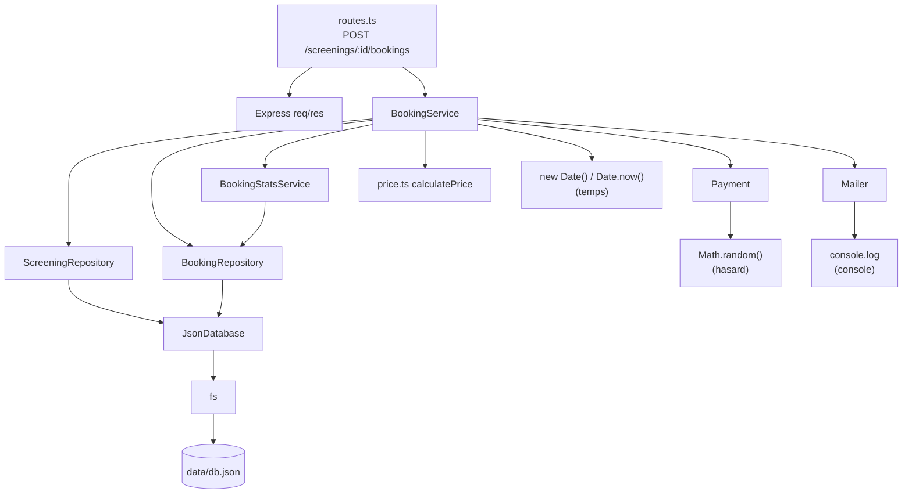

# Audit du code legacy CinéResa

Fichier analysé : `src/server.ts` (151 lignes).

## 1. Cartographie des responsabilités

Légende : **PRÉS** = présentation (HTTP), **MÉTIER** = règle métier, **DATA** = accès aux données, **INFRA** = mail, paiement, temps, hasard.

| Lignes | Bloc de code | Responsabilité |
|---|---|---|
| 3-8 | imports, `express()`, `express.json()` | PRÉS (configuration HTTP) |
| 10 | `DB_FILE` (chemin du fichier JSON) | DATA |
| 12-18 | `readDb`, `writeDb` | DATA (lecture et écriture du disque via `fs`) |
| 23, 42-43 | déclaration de la route `GET /screenings`, `res.json` | PRÉS |
| 24 | `readDb()` | DATA |
| 25 | `new Date()` | INFRA (temps) |
| 27-28 | parcours des séances, ignorer celles déjà commencées | MÉTIER (+ INFRA temps) |
| 29-32 | calcul des places prises | MÉTIER |
| 33-40 | construction de l'objet séance, `remaining = capacity - taken` | MÉTIER (+ formatage de réponse) |
| 49 | déclaration de la route `POST /screenings/:id/bookings` | PRÉS |
| 50-51 | `readDb()`, recherche de la séance | DATA |
| 52 | séance introuvable : 404 | PRÉS (+ MÉTIER) |
| 54-57 | validation de l'email, 400 | MÉTIER (règle de validation) + PRÉS (400) |
| 59-62 | validation de `seats` (1 à 6), 400 | MÉTIER + PRÉS (400) |
| 64-66 | séance déjà commencée, 409 | MÉTIER + INFRA (temps) + PRÉS (409) |
| 68-75 | places restantes et capacité, 409 | MÉTIER + PRÉS (409) |
| 77-81 | calcul du prix (tarif étudiant, remise groupe) | MÉTIER |
| 83-85 | paiement (`Math.random`), 402 | INFRA (paiement, hasard) + PRÉS (402) |
| 87-96 | création de l'objet réservation (id, statut, dates) | MÉTIER + INFRA (`Date.now`, `new Date`) |
| 97-98 | `push` + `writeDb` | DATA |
| 100-104 | e-mail de confirmation (`console.log`) | INFRA (mail) |
| 106 | `res.status(201).json(booking)` | PRÉS |
| 112 | déclaration de la route `DELETE /bookings/:id` | PRÉS |
| 113-114 | `readDb()`, recherche de la réservation | DATA |
| 115-116 | introuvable (404), déjà annulée (409) | MÉTIER + PRÉS |
| 118 | recherche de la séance | DATA |
| 119-122 | annulation impossible à moins de 2h, 409 | MÉTIER + INFRA (temps) + PRÉS |
| 124-126 | passage à `CANCELLED`, `cancelledAt`, `writeDb` | MÉTIER + INFRA (temps) + DATA |
| 128 | e-mail d'annulation | INFRA (mail) |
| 129 | `res.json(b)` | PRÉS |
| 135 | déclaration de la route `GET /bookings` | PRÉS |
| 136-137 | `readDb()`, filtre par email | DATA |
| 138-143 | jointure réservation + séance, `res.json` | MÉTIER (jointure) + PRÉS |
| 146-149 | port, `app.listen` | PRÉS (démarrage) |
| 151 | `export default app` | PRÉS |

**Synthèse :** presque chaque route mélange HTTP, règles métier, accès disque, temps, hasard et mail dans une seule fonction. Aucune responsabilité n'est isolée.

## 2. Code smells

| # | Smell | Lignes | Conséquence concrète |
|---|---|---|---|
| 1 | **Duplication** du calcul des places prises | 29-32 et 69-72 | Si la règle change (nouveau statut, places bloquées), il faut penser à la modifier aux deux endroits. Sinon la liste affiche des places qui ne sont pas réservables. |
| 2 | **God function** : le handler POST fait tout | 49-107 | Validation, règles, prix, paiement, écriture, mail et HTTP sont mélangés. Impossible de tester ou réutiliser une règle isolément. |
| 3 | **Nombres magiques** | `6` (60), `0.7` (79), `4` et `0.9` (81), `0.05` (84), `2 * 60 * 60 * 1000` (120) | Le sens de ces valeurs n'est pas lisible. Changer une remise oblige à chercher chaque occurrence. |
| 4 | **Dépendances cachées non contrôlables** (`Math.random`, `new Date`, `fs`, `console.log`) | 25, 28, 64, 84, 88, 95, 119, 125 ; 13, 17 ; 101-104, 128 | Le paiement échoue au hasard (constaté pendant les tests : 402 sans raison). Les résultats dépendent de l'heure réelle et du disque. On ne peut pas écrire de test fiable sans modifier le code. |
| 5 | **Typage `any`** | 12, 16, 51, 114, 118, 137, 139, 140 | TypeScript ne détecte aucune faute de frappe (`b.seat` au lieu de `b.seats`). L'erreur n'apparaît qu'à l'exécution. |
| 6 | **Identifiant fragile** `"b" + Date.now()` | 88 | Deux réservations dans la même milliseconde auraient le même id : l'annulation toucherait la mauvaise. |
| 7 | **Cas non géré** : séance introuvable dans le DELETE | 118-119 | Si la séance d'une réservation n'existe plus, `s` est `undefined` et `s.startsAt` fait planter la route (erreur 500). `GET /bookings` gère ce cas (ligne 141), pas le DELETE : incohérence. |
| 8 | **Codes HTTP et messages dispersés** | 52, 56, 61, 65, 74, 85, 115, 116, 121 | Pour changer un message ou un code, il faut parcourir toutes les routes. Rien ne garantit la cohérence. |
| 9 | **Logique métier dans la couche HTTP** | 52-85, 115-122 | Les règles ne sont pas réutilisables hors d'Express (autre interface, tâche planifiée, test unitaire). |

## 3. SOLID : violations dans le legacy

| Lettre | Violation | Lignes |
|---|---|---|
| **S** (responsabilité unique) | Le handler `POST /screenings/:id/bookings` valide, applique les règles, calcule le prix, paie, écrit sur le disque, envoie le mail et répond en HTTP. Il a une dizaine de raisons de changer. | 49-107 |
| **O** (ouvert/fermé) | Ajouter un tarif (senior, par exemple) ou une remise oblige à modifier le handler existant (calcul du prix, création de la réservation) au lieu d'ajouter du code. | 78-81, 92 |
| **L** (substitution de Liskov) | Ne s'applique pas vraiment : le legacy n'a ni héritage, ni interface, ni type à substituer. Il n'y a donc aucune sous-classe qui puisse trahir le contrat de son parent. | - |
| **I** (ségrégation des interfaces) | Il n'y a pas d'interface, mais le principe est visible : chaque route reçoit tout l'objet `db` (séances et réservations) alors qu'elle n'a besoin que d'une partie. | 24, 50, 113, 136 |
| **D** (inversion des dépendances) | Le handler dépend directement de choses concrètes : `fs` (via `readDb`/`writeDb`), `Math.random`, `new Date`, `console.log`. Rien n'est injecté, donc rien n'est remplaçable. | 13, 17, 25, 64, 84, 101-104 |

### S — Single Responsibility Principle (responsabilité unique)
Avant la refactorisation, `server.ts` gérait les routes HTTP, les règles métier, l'accès aux données, le paiement et les e-mails dans les mêmes fonctions.
Après la refactorisation, ces responsabilités sont réparties entre plusieurs classes :
- `ScreeningService` : gestion des séances.
- `BookingService` : règles métier des réservations.
- `BookingStatsService` : calcul des places prises et restantes.
- `ScreeningRepository` et `BookingRepository` : accès aux données.
- `Payment` : simulation du paiement.
- `Mailer` : envoi des messages de confirmation et d'annulation.

### O — Open/Closed Principle (ouvert/fermé)
Le calcul du prix est isolé dans `price.ts`, ce qui permet de le tester et de le modifier sans réécrire les routes HTTP.
Cependant, l'ajout de nouvelles règles tarifaires nécessite encore de modifier `calculatePrice`.

### L — Liskov Substitution Principle (substitution de Liskov)
Ce principe est peu concerné par le projet : les classes utilisées ne reposent pas sur une hiérarchie d'héritage métier.
`BookingError` hérite de `Error` et conserve son comportement général d'erreur.

### I — Interface Segregation Principle (ségrégation des interfaces)
Le projet n'utilise pas encore d'interfaces TypeScript dédiées. Les services dépendent directement des classes concrètes des repositories, du paiement et du mailer.
Il serait possible de définir des interfaces pour faciliter le remplacement de ces dépendances et les tests.

### D — Dependency Inversion Principle (inversion des dépendances)
La séparation en services et repositories améliore l'organisation du code.
Cependant, les services instancient directement leurs dépendances avec `new`. Ils restent donc couplés aux implémentations concrètes, notamment pour le paiement et l'accès aux données.
Une amélioration possible serait d'injecter ces dépendances dans les constructeurs.

## 4. Graphe de dépendances de `POST /screenings/:id/bookings`

## 5. Remplaçable dans un test sans modifier le code ?

| Dépendance | Remplaçable ? | Pourquoi |
|---|---|---|
| Express (`req`, `res`) | Oui | `BookingService` ne les connaît pas : on l'appelle directement. |
| `price.ts` | Oui | Fonction pure, aucune dépendance. |
| `ScreeningRepository`, `BookingRepository`, `BookingStatsService` | Non | Instanciés avec `new` dans `BookingService` : impossible d'en injecter un faux. |
| `Payment` (`Math.random`) | Non | Instancié avec `new`, et le hasard est codé en dur. |
| `Mailer` (`console.log`) | Non | Instancié avec `new`. On pourrait espionner `console.log`, mais ce n'est pas un vrai remplacement. |
| Le temps (`new Date`, `Date.now`) | Non | Appelés directement dans le service, pas de moyen de figer l'horloge. |
| Le disque (`fs`, `db.json`) | Non | `JsonDatabase` lit et écrit toujours le vrai fichier. |

## 6. Bilan : testabilité après le découpage en couches

### Ce qu'on peut tester sans serveur ni `data/db.json`

| Règle | Où elle se trouve | Pourquoi c'est testable |
|---|---|---|
| Calcul du prix (tarif étudiant -30 %, remise groupe -10 %, arrondis) | `price.ts` (`calculatePrice`) | Fonction pure : entrées en paramètres, résultat renvoyé, aucune dépendance. Testée dans `tests/price.test.ts`. |
| Calcul des places restantes | `BookingStatsService.countRemainingSeats` | Simple soustraction sur des nombres, sans lecture du disque. |

### Ce qui reste impossible à tester

| Règle | Pourquoi |
|---|---|
| Email invalide, nombre de places hors 1-6 | Ces contrôles sont dans `createBooking`, après `findById`, qui lit `db.json`. Pour atteindre la validation il faut d'abord un vrai fichier. |
| Séance introuvable, séance déjà commencée | Lecture du disque + `new Date()` : le résultat dépend de l'heure réelle et du contenu de `db.json`. |
| Capacité dépassée | `countTakenSeats` lit les réservations sur le disque. |
| Paiement refusé | `Payment` utilise `Math.random()`, instancié avec `new` : on ne peut pas forcer le résultat. |
| Annulation à moins de 2 h | Dépend de `new Date()` : impossible de figer l'heure. |
| E-mails de confirmation et d'annulation | `Mailer` écrit avec `console.log`, sans moyen de le remplacer proprement. |
| Création et enregistrement d'une réservation | Écrit dans le vrai `db.json`, avec un id basé sur `Date.now()`. |

### Cause commune

Le découpage en couches a séparé les responsabilités, mais pas les dépendances : chaque service crée ses collaborateurs avec `new` (repositories, paiement, mailer), et appelle directement `new Date()` et `Date.now()`. Rien ne peut donc être remplacé dans un test. Pour rendre ces règles testables, il faut inverser la dépendance : le cœur définit des interfaces (ports) et reçoit ses dépendances par le constructeur, avec une horloge, un paiement et un stockage injectables. C'est l'objet du TP2.